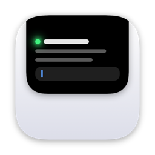
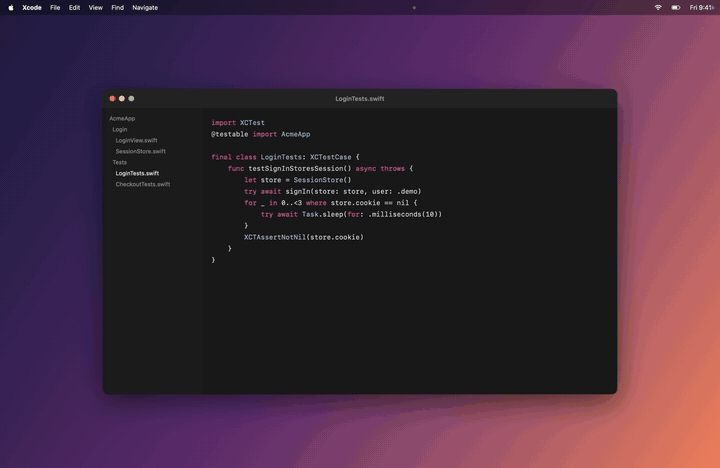
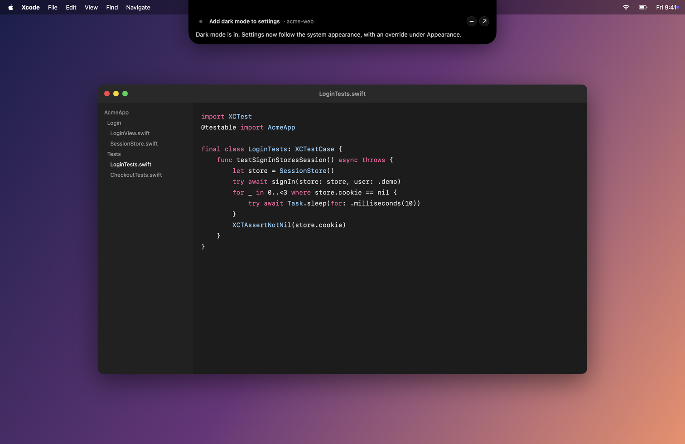
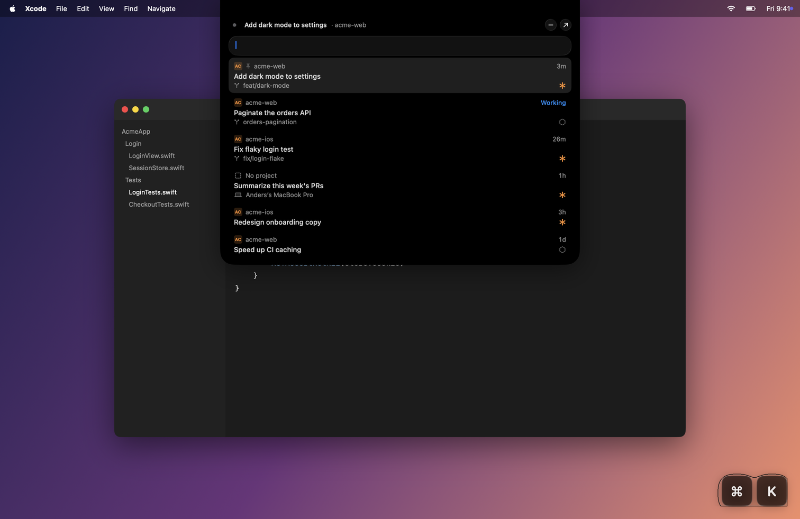
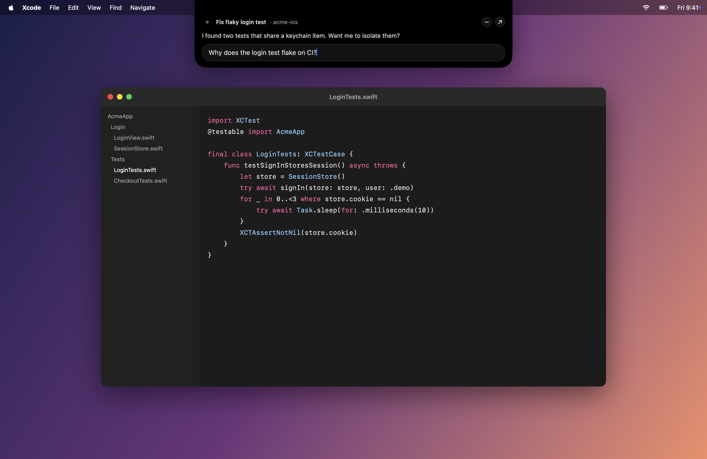
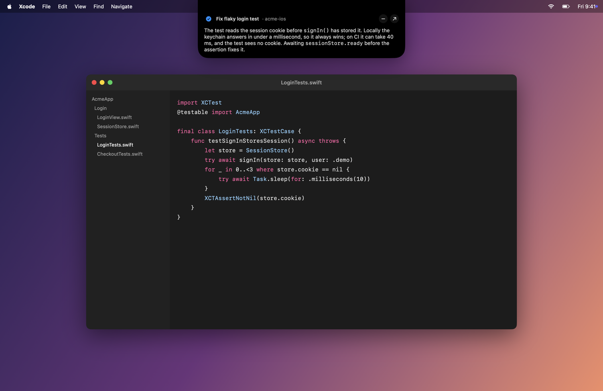
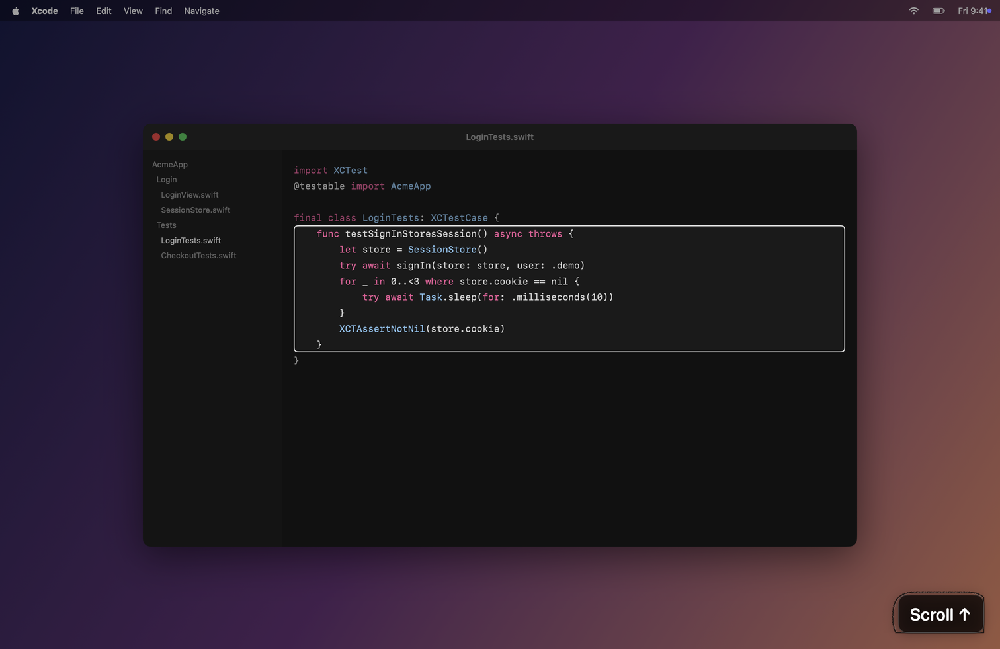
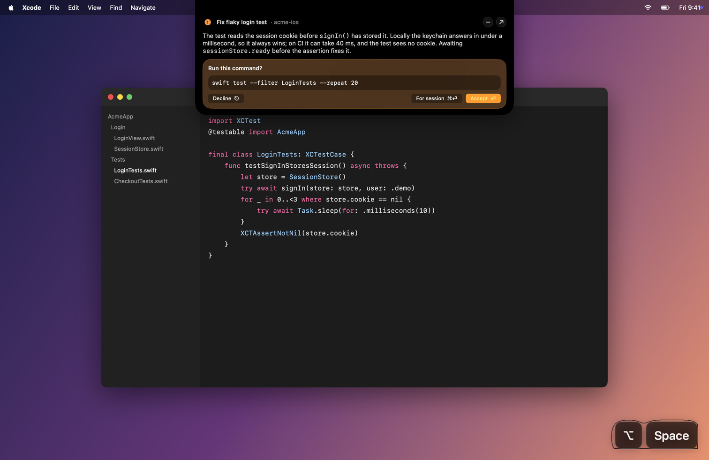
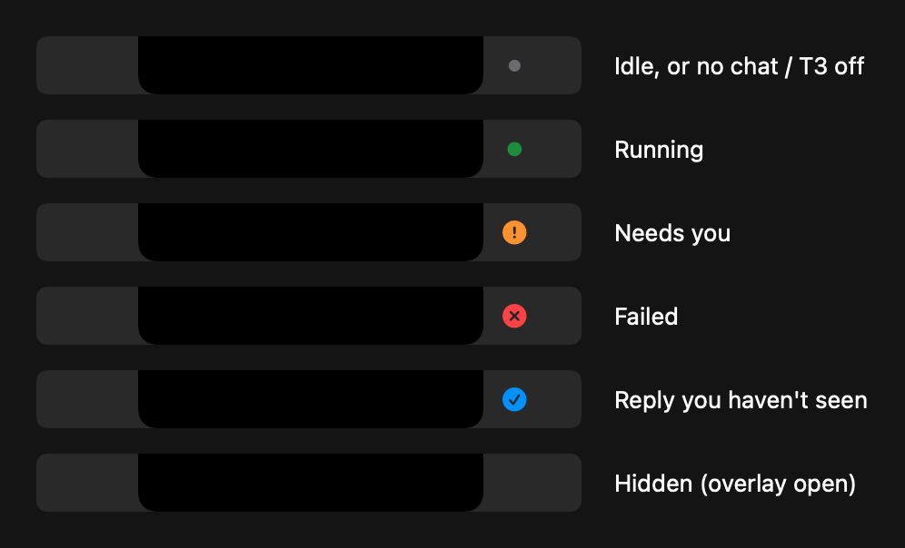

<p align="center"></p>

<h1 align="center">T3 Notch</h1>

A Dynamic-Island-style prompt bar for [T3 Code](https://github.com/pingdotgg/t3code). Press **⌥Space** in
any app and an island grows out of your MacBook's notch. Type a prompt, clip parts of your screen, and send
it to a T3 chat without leaving what you're doing. The agent's reply streams into the island, and a small dot
beside the notch shows the chat's status.

It is a small native Swift app (SwiftUI and AppKit, no dependencies) that talks to the T3 Code desktop app
running on the same Mac.



The keys being pressed show in the bottom-right corner. [Watch the full-quality video](docs/demo.mp4).

## Features

- **Prompt from anywhere.** ⌥Space opens the island over any app, fullscreen ones included. The input appears
  when you start typing. Sending hides the island and hands focus back to the app you were in.
- **Live replies.** While the agent works, the island shows its thinking (and, with **Show Commands While
  Working** on in settings, its current step: `$ swift test`, `Editing Store.swift`). Then the reply streams in, sliding the old one out as it blurs in.
  Images in the exchange show as thumbnails; hover one to see it larger.
- **Queue or steer.** ⏎ queues your message after the running turn; ⌘⏎ steers the turn that is running.
- **Pick the chat.** ⌘K opens a list that mirrors T3's sidebar: pinned, then active, then the rest, with
  project, status, time, branch and provider. With no chat picked, the island opens on this list.
- **Clip the screen.** ⌘P freezes the screen. Hover to pick a UI element (scroll to grow or shrink it), or drag
  a rectangle, and the clip is attached to your next message as an image.
- **Answer approvals.** When the agent asks for permission or has a question, the island opens with the
  request. ⏎ accepts, ⌘⏎ accepts for the session, ⎋ declines.
- **Hand off to T3.** ⌘O opens the chat in T3 and carries your draft text and clips into T3's chat box.
- **Status dot.** While the island is hidden, a dot right of the notch shows the chat's state. It hides while
  an app is fullscreen.

<table>
  <tr>
    <td></td>
    <td></td>
  </tr>
  <tr>
    <td align="center">The island on a chat</td>
    <td align="center">⌘K: pick the chat</td>
  </tr>
  <tr>
    <td></td>
    <td></td>
  </tr>
  <tr>
    <td align="center">The input appears as you type</td>
    <td align="center">A finished reply pops up</td>
  </tr>
  <tr>
    <td></td>
    <td></td>
  </tr>
  <tr>
    <td align="center">⌘P: clip an element of the screen</td>
    <td align="center">Answer approvals in place</td>
  </tr>
</table>



## Requirements

- macOS 26 or later, on an Apple silicon Mac. A notch is optional: without one, the island grows from a
  drawn notch at the top of the screen.
- The [T3 Code](https://github.com/pingdotgg/t3code) desktop app, running on the same Mac.

## Install

Download `T3-Notch-<version>.zip` from the [latest release](https://github.com/lille-morille/t3-notch/releases/latest),
unzip it, and move **T3 Notch.app** to Applications. It is signed and notarized, so it opens without warnings.
Then turn on **Launch at login** in settings (right-click the status dot).

**Updates.** T3 Notch checks for new releases. When one is out, a green ↓ button appears in the island, left of
the – button (and in settings). One click downloads it, checks that it is notarized and from
the same developer, replaces the app and relaunches.

### With an agent

Paste this into Claude Code, Codex, T3 Code or another coding agent on the Mac you want it on:

```text
Install T3 Notch, a macOS notch overlay for T3 Code, from https://github.com/lille-morille/t3-notch.

1. Check the requirements: macOS 26 or later (`sw_vers -productVersion`) and the T3 Code desktop
   app installed and running (`~/.t3/userdata/server-runtime.json` exists). Stop and tell me if
   either is missing.
2. Download the .zip asset of the latest release
   (https://api.github.com/repos/lille-morille/t3-notch/releases/latest lists it), unzip it with
   `ditto -x -k`, move "T3 Notch.app" to /Applications (or ~/Applications), and open it.
3. Confirm it runs (`pgrep -x T3Notch`); right-clicking the status dot beside the notch opens
   settings, which should say "Connected".
4. Tell me how to use it: ⌥Space opens the island; ⌘K picks the chat; ⌘P clips the screen and asks
   once for Screen Recording and Accessibility (the island shows a button that opens the right
   System Settings page); right-click the dot (or ⌘, in the island) for settings, including
   "Launch at login"; updates show as a
   green button in the island.

If there is no release yet, build from source instead: clone the repo to ~/code/t3-notch and run
`make install` there (needs Xcode 26 / Swift 6.2). Do not change the code; if anything fails, show
me the error.
```

### From source

Needs Xcode 26 or its command line tools (Swift 6.2).

```sh
git clone https://github.com/lille-morille/t3-notch.git ~/code/t3-notch
cd ~/code/t3-notch
make install   # builds, signs, copies to ~/Applications and starts it
```

**Signing.** `make app` signs with the first *Apple Development* certificate in your keychain, so macOS keeps
the Screen Recording and Accessibility permissions across rebuilds. Without one it signs ad hoc, which works,
but each rebuild asks for those permissions again. Choose an identity with `make SIGN_ID=<hash> install`.

Releases are built by CI; see [RELEASING.md](RELEASING.md).

## Keys

| Key | Action |
| --- | --- |
| ⌥Space | Show or hide the island (rebind in settings) |
| ⏎ | Send, or queue after the running turn. Accepts a pending approval when the input is empty |
| ⌘⏎ | Steer the running turn. Accepts an approval for the session when one is showing |
| ⎋ | Decline a pending approval, otherwise close |
| ⌘K | Pick the chat |
| ⌘P | Clip part of the screen into the next message |
| ⌘O | Open the chat in T3, taking the draft and clips along |
| ⌘. | Stop the running agent |
| ⌃J ⌃N / ⌃K ⌃P | Down / up in the chat list, or scroll the reply |
| ⌘Z / ⌃Z | Bring back a removed clip |
| ⌥⇧Space | Hide or show the status dot, from any app (rebind in settings) |
| ⌘, | Open settings (also: right-click the status dot) |

### Clipping

⌘P freezes every screen.

- **Pick an element** by hovering over it. Scroll to grow it out to its parent or shrink it back; the level
  below the smallest element is the whole window. The level is kept until you send.
- **Draw a rectangle** by dragging.
- **Releasing** adds the clip and returns to the island. Hold **⇧** while releasing to keep clipping.
- **Remove a clip** by clicking it: on the frozen screen while clipping, or on its thumbnail in the island.
  Hover a thumbnail for a larger preview.

Clipping needs **Screen Recording**. Element picking also needs **Accessibility**; without it, hovering picks
whole windows. When a permission is missing, the island shows a button that opens the exact System Settings
list, so only the toggle is left.

### Status dot

| Dot | Meaning |
| --- | --- |
| Grey | Idle, no chat picked, or T3 not running |
| Dark green | The agent is working |
| Orange ! | It needs you: an approval, a question, or a protocol break |
| Red ✕ | The last run failed |
| Blue ✓ | A reply you haven't opened yet |

Click the dot to open the island. It hides while an app is fullscreen, and ⌥⇧Space (or **Hide status dot** in
settings) hides it until you show it again.

### Settings

Right-click (or ⌃-click) the status dot, or press ⌘, in the island. Esc or a click elsewhere closes it.

- **Expand on notch hover** (on by default): moving the pointer onto the notch peeks at the focused chat.
- **Show when chat finishes** (on by default) pops the island open with the reply when the chat's run ends,
  unless you are already in T3 Code. Clicking the popped-up island opens it fully.
- **Show commands while working** (off by default): besides the thinking, show the agent's commands and tool
  steps while it works.
- **Hide status dot** (⌥⇧Space).
- **Launch at login**.
- **Show island** and **Toggle dot**: click the shortcut, then press new keys to rebind it (⎋ cancels).
- **Reconnect**, **New token** and **Logs**; the circular arrows check for updates (green with the new version when one is out: click to install); the power button quits.

## How it works

T3 Notch reads `~/.t3/userdata/server-runtime.json` to find the local T3 server. On first run it gets its own
token with `t3 auth session issue --label notch-overlay` and keeps it in
`~/Library/Application Support/T3Notch/token` (mode 0600). The token has only the `orchestration:read` and
`orchestration:operate` scopes; revoke it in T3's sessions at any time.

It then connects to T3's WebSocket RPC at `/ws`, the protocol T3's own UI uses. That protocol is internal, not
a public API, so a T3 update can break it. When that happens, the island shows **T3 protocol changed** with a
button that opens a ready-to-send T3 draft. The draft carries the frame log and the T3 versions, so an agent can
fix the client. [AGENTS.md](AGENTS.md) documents the protocol and the code.

T3 keeps chat box drafts only inside its own window, so the island's draft is separate from T3's. ⌘O hands the
island's draft over: the text goes in through T3's `t3code://` link, and clips are pasted in through T3's
**Edit › Paste** (this needs Accessibility).

## Troubleshooting

- **"T3 Code isn't running"**: start the T3 Code desktop app. The island connects within a few seconds.
- **"T3 protocol changed"**: T3 updated its internal protocol. Click **Open fix draft in T3** and send it to an
  agent in this repo.
- **Asked for permissions after every rebuild**: there is no Apple Development certificate, so the app was
  signed ad hoc. See *Signing* above.
- **Clips are not pasted on ⌘O**: turn on Accessibility for T3 Notch. Each handoff is logged to
  `~/Library/Logs/T3Notch/handoff.log`.
